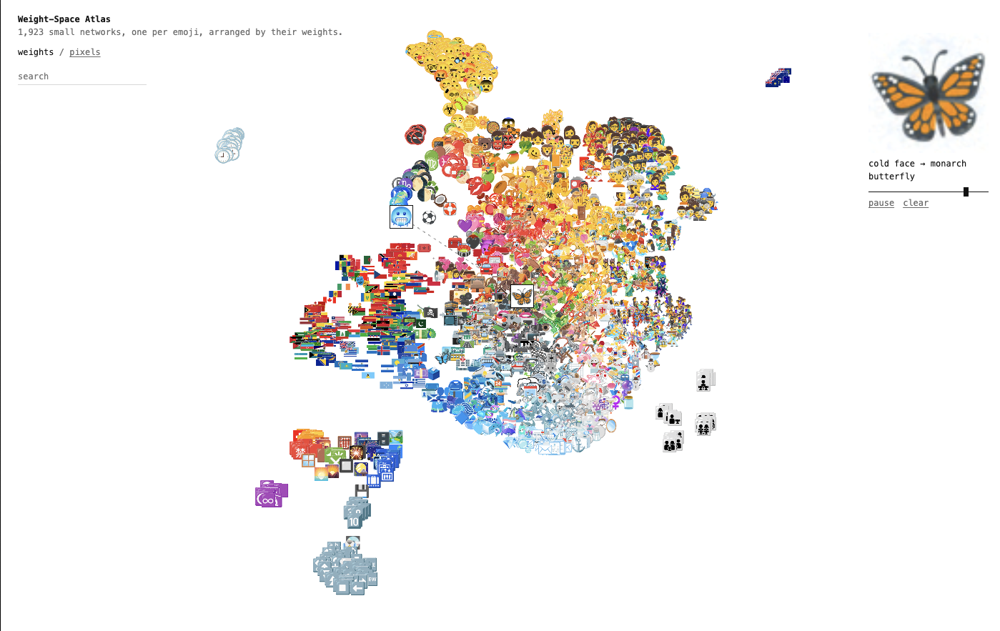
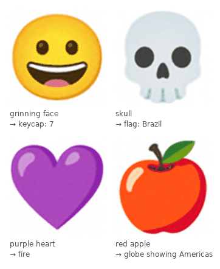

# Emoji in Weight Space

A map of 1,923 neural networks, each fit to one emoji, laid out by their weights. [Live demo](https://leann-z.github.io/weightspace-map/).

[](https://leann-z.github.io/weightspace-map/)

## Overview

An implicit neural representation (INR) stores an image as the weights of a small network that maps a pixel coordinate (x, y) to its RGB color. I fit one INR per emoji, embed the 1,923 weight vectors in 2D, and draw each network's own rendering at its position, giving a browsable map of weight space. An extra training term makes linear interpolation between any two networks' weights render as a cross-fade of their images.

## Method

- **Data:** 1,923 [Noto Emoji](https://github.com/googlefonts/noto-emoji), 64x64.
- **Model:** SIREN, 3 hidden layers of 64 units, 8,707 parameters.
- **Shared initialization:** without it, permutation symmetry makes weights incomparable across networks (see [INR2action](https://github.com/leann-z/INR2action)).
- **Training:** MSE plus an interpolation loss: random weight blends of two networks must draw the same blend of their images.
- **Embedding:** PCA, then UMAP.
- **Web:** forward pass in JavaScript, everything rendered live from the weights.

## Results



| Metric | Value |
|---|---|
| Reconstruction PSNR (mean / 5th percentile / min) | 39.8 / 36.2 / 32.3 dB |
| Weight midpoint vs. pixel cross-fade, PSNR | 25.8 dB (13.6 dB without the interpolation term, 128-network run at width 32) |
| Shared 10-nearest neighbors, weight vs. pixel layout (2D) | 23% (chance 0.5%) |
| Same, in the 50-d PCA spaces | 52% |


## Reproduction

```
pip install -r requirements.txt
python scripts/prepare_data.py   # download and preprocess emoji             
python scripts/train.py          # fit all networks                          
python scripts/embed.py          # PCA, UMAP, grid snapping, neighbor metrics 
python scripts/export_web.py     # float16 weights + metadata -> web/atlas.bin

```

## Limitations

- UMAP preserves local neighborhoods only. Comparability depends on the shared initialization. 

## Credits

Emoji images: [Noto Emoji](https://github.com/googlefonts/noto-emoji) by Google, Apache License 2.0. Emoji names and groups: Unicode [emoji-test.txt](https://unicode.org/Public/18.0.0/emoji/emoji-test.txt). Code: MIT, see [LICENSE](LICENSE).
